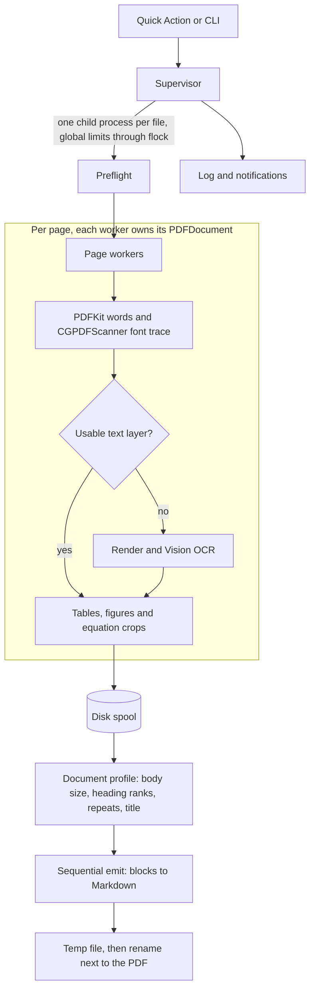

# pdf2md

Convert PDFs to compact Markdown from Finder, on your Mac, with no network calls.

Select PDFs in Finder, right-click, choose **Quick Actions > Convert to Markdown**, and a `.md`
file appears next to each one. It is built for turning lecture slides, books and long technical
documents into study material for LLMs, so it keeps the structure and drops the noise.

## Features

- **Structure:** one `#` title, headings from `##` to `######` that follow the PDF's outline when
  it has one, slide titles, nested lists, reflowed paragraphs with hyphenation and ligatures
  repaired, and fenced code with its indentation rebuilt from geometry.
- **Tables:** GFM tables, read from the rules a page draws or found by Apple Vision when it draws
  none, with cell text taken from the PDF's text layer when it has one.
- **Footnotes:** Markdown footnotes linked to their markers, so a note doesn't interrupt a sentence.
- **Math:** `$…$` and `$$…$$` with sub and superscripts. A formula that can't be written reliably
  on one line, such as a stacked fraction, also gets a cropped image.
- **Images:** figures cropped into `<name>_assets/`. Tiny images, page backgrounds, duplicates and
  images repeating on 30% of pages are left out.
- **Diagrams:** drawings made of paths, such as TikZ, are cropped too. Their labels follow in a
  `text` fence, placed by position, so a reader of the text alone still gets the words.
- **OCR:** scanned pages go through Apple Vision, in English and Spanish.
- **Token efficiency:** headers and footers repeating on 30% of pages are removed, along with
  double blank lines and trailing spaces. The only HTML is the `<!-- page N -->` marker.
- **No limits:** no cap on page count, file size or file count, and memory stays flat as pages
  grow. See [Performance](#performance).
- **Isolation:** each file runs in its own process, so a crash or hang costs only that file.
- **Offline:** no networking code. PDFKit and Vision run on-device. The only package dependency is
  `swift-argument-parser`.

## Requirements

- macOS 26 or later. Developed and tested on macOS 27 on Apple silicon.
- Xcode, to build from source (developed with Xcode 27.2). The installed tool doesn't need Xcode.

Builds are ad-hoc signed for the Mac they were built on, so there is no binary download yet. See
the [roadmap](#roadmap).

## Install

```bash
git clone https://github.com/nemura0/pdf2md.git
cd pdf2md
make install
```

This makes a release build, copies it to `~/.local/bin/pdf2md`, puts the workflow in
`~/Library/Services` and refreshes the Services menu. You can run it again to update.

`make uninstall` removes the binary, the workflow, the logs and the tool's caches. Markdown files
you have converted stay where they are.

### First run

- **Files and folders:** macOS may ask for access the first time you convert something on the
  Desktop, in Documents, in Downloads or on an external drive. If a file fails with a permission
  error, the notification and the log name the setting to change, under **System Settings >
  Privacy & Security**.
- **Quick Action:** if it isn't in the menu, search for "Extensions" in System Settings and turn on
  **Convert to Markdown** under Finder.
- **First OCR:** the first page needing Vision after an install takes about 40 seconds while macOS
  prepares the model for the new binary. Later pages take a fraction of a second. Slides and pages
  with table-like layouts use Vision too, so this can happen on a file with no scanned pages.

## Usage

### From Finder

Select one or more PDFs, then right-click and choose **Quick Actions > Convert to Markdown**. The
conversion runs in the background. One notification says it started, and another reports the
result:

```text
Converted 3 of 4 in 2m 14s
exam.pdf: password-protected
```

To stop a conversion, run `~/.local/bin/pdf2md --cancel`.

### From the terminal

```text
pdf2md [--output-dir DIR] [--overwrite] [--no-images] [--no-page-markers] [--no-front-matter]
       [--ocr auto|always|never] [--jobs N] [--notify] [--detach] [--cancel] [--verbose] <pdf>...
```

| Option | Effect |
|---|---|
| `--output-dir DIR` | Write here instead of next to each PDF. An error if `DIR` can't be written |
| `--overwrite` | Replace an existing output instead of adding `(1)`, `(2)`… |
| `--no-images` | Don't extract figures |
| `--no-page-markers` | Omit `<!-- page N -->` |
| `--no-front-matter` | Omit the YAML front matter |
| `--ocr MODE` | `auto` decides per page, `always` and `never` force it |
| `--jobs N` | Page tasks at once. Default: performance cores |
| `--notify` | Notify at the start and at the end |
| `--detach` | Run in a new session and return immediately |
| `--cancel` | Stop running jobs and remove their partial output |
| `--verbose` | Print statistics per file |

Exit codes: `0` all converted, `1` some failed, `2` usage error.

Each file gets one line in `~/Library/Logs/pdf2md/pdf2md.log`, with pages, OCR'd pages, tables,
images, math spans, duration and any error.

### Where output goes

`<name>.md` goes next to the PDF, with images in `<name>_assets/`. An existing file is never
replaced unless you pass `--overwrite`: the next free name is used instead, such as `<name> (1).md`
with `<name> (1)_assets/`. If the PDF's folder can't be written, output goes to `~/Downloads` and
the result says so.

## Example

Page 6 of a generated slide deck, `slides.pdf`:

```text
┌─────────────────────────────────────────────────┐
│  Evaluaciones                                   │
│                                                 │
│  ┌────────────────┬────────┬─────────────┐      │
│  │ Evaluación     │ Semana │ Ponderación │      │
│  ├────────────────┼────────┼─────────────┤      │
│  │ Prueba 1       │ 5      │ 30%         │      │
│  │ Prueba 2       │ 10     │ 30%         │      │
│  │ Proyecto final │ 15     │ 40%         │      │
│  └────────────────┴────────┴─────────────┘      │
│                                                 │
│  Se aprueba con nota 4,0 en cada una.           │
└─────────────────────────────────────────────────┘
```

comes out in `slides.md` as:

```markdown
---
title: "Programación Orientada a Objetos"
source: "slides.pdf"
pages: 7
converted: "2026-01-01"
tool: "pdf2md 1.0.0"
---

# Programación Orientada a Objetos

<!-- page 6 -->

## Evaluaciones

| Evaluación | Semana | Ponderación |
| --- | --- | --- |
| Prueba 1 | 5 | 30% |
| Prueba 2 | 10 | 30% |
| Proyecto final | 15 | 40% |

Se aprueba con nota 4,0 en cada una.
```

This is an excerpt: pages 1 to 5 and 7 are cut. Whole outputs for the generated fixtures are in
[`Tests/PDF2MDKitTests/Golden/`](Tests/PDF2MDKitTests/Golden/).

## How it works



Three decisions shape the rest:

- **Fonts come from the content stream, text from PDFKit.** PDFKit reports `Helvetica` for fonts
  not installed on the Mac, which would hide the math, code and bold in most LaTeX and Office PDFs
  ([ADR-0003](docs/adr/0003-hybrid-text-pipeline.md)).
- **Pages are spooled to disk, then emitted in order.** Heading ranks and repetition need
  whole-document statistics, and spooling keeps memory flat. Workers also reopen their document
  every 100 pages, because an open `PDFDocument` keeps growing
  ([ADR-0006](docs/adr/0006-spool-then-emit.md)).
- **One process per file, with limits shared across runs.** A crash inside CoreGraphics can't take
  down the other files, and two Quick Action runs can't overload the machine
  ([ADR-0007](docs/adr/0007-process-per-file.md)).

All the decisions are in [`docs/adr/`](docs/adr/).

## Performance

Measured with `make bench` on an Apple M5 (4 performance and 6 efficiency cores) with 16 GB of RAM,
on generated PDFs. Peak memory is the whole process tree.

| Input | Pages | Time | Pages/s | Peak memory |
|---|---:|---:|---:|---:|
| Text | 175 | 1.1 s | 162.0 | 117 MB |
| Text | 350 | 2.1 s | 168.3 | 189 MB |
| Text | 700 | 4.1 s | 170.7 | 215 MB |
| Text | 1400 | 8.0 s | 174.1 | 222 MB |
| Slides | 400 | 48.1 s | 8.3 | 276 MB |
| Scanned | 300 | 24.9 s | 12.1 | 726 MB |
| Scanned | 700 | 55.0 s | 12.7 | 851 MB |
| Scanned | 1400 | 127.9 s | 10.9 | 913 MB |
| Three files at once (text and slides) | 2500 | 20.8 s | 120.0 | 632 MB |

Text memory levels off: doubling from 700 to 1400 pages adds 7 MB. Scanned files use more because
Vision works on full-page renders, and the figures above also count the memory-mapped PDF. Growth
slows as scans get longer: 726 MB at 300 pages, 851 MB at 700 and 913 MB at 1400. In a sampled 1400-page
run, physical footprint peaked at about 580 MB early on, then stayed between 350 and 440 MB until
the end. Three points can't rule out a very small slope, and footprint was only sampled at that one
size.

## Limitations

The heuristics have been tuned on generated PDFs, including hand-written pdfTeX-style files with
unregistered fonts, and on one real book: a 488-page LuaLaTeX textbook in Spanish. They have not been
checked against a wider set of real documents, so expect rough edges, above all on Office files.

- **Scanned pages:** OCR has no font information, so there is no bold, code isn't fenced and small
  headings can be read as text.
- **Scanned tables:** Vision can drop cells holding a single letter. Tables with a text layer aren't
  affected.
- **OCR languages:** recognition is set up for English and Spanish. Other languages will read worse
  and may be "corrected" toward those two.
- **Inline styles:** bold and italic inside a paragraph aren't kept.
- **Math:** this is not ML-grade LaTeX. Stacked formulas become a best-effort linear form plus an
  image. A fraction set at body size inside a display equation can flatten with no image. A space
  glyph set in a math font can shift where a word splits.
- **Diagrams:** the labels fence holds the words, not the arrows, so a relation between two boxes is
  only in the image. Slides are skipped, and an unusual drawing can be missed or a framed paragraph
  taken for one ([ADR-0010](docs/adr/0010-what-a-page-draws.md)).
- **Footnotes:** they are found under a short rule, in small print with a raised marker. Notes in
  another shape stay in the text, such as a table's own notes.
- **Symbols with no text:** a symbol font with no text mapping can't be read. The check mark from
  LaTeX's `bbding` is recognized, and any other symbol comes out as `■`.
- **Monospace headings:** a large heading set in a monospace font becomes a code fence, unless the
  PDF's outline names it.
- **Zero-page PDFs:** these are reported as corrupt, because PDFKit and CoreGraphics both refuse to
  open them.
- **Locked PDFs:** these are skipped with a reason, never cracked.
- **Online-only files:** Dropbox and iCloud placeholders are downloaded by reading them, and skipped
  with a reason if that fails. The detection is tested, but the download itself hasn't been tried
  against a real provider.
- **Image-heavy files:** the benchmarks don't include a document with many distinct images, so the
  memory figures below don't speak for that case.

## Development

```bash
make build     # debug build
make test      # test suites, including goldens
make fixtures  # generate synthetic PDFs into Fixtures/
make bench     # pages/s and peak RSS, plus memory slope across page counts
make lint      # swift format lint and architecture invariants
bash scripts/e2e.sh  # real install, Automator run, cancel, crash and hang isolation
```

`scripts/e2e.sh` replaces your installed copy and runs the real uninstall. It refuses to start while
conversions are running, and it restores your log afterwards.

Real documents never enter the repo: `*.pdf` is ignored and every fixture is generated. Project
conventions and invariants are in [`CLAUDE.md`](CLAUDE.md).

### CI

CI runs lint, build and tests on GitHub's `xcode-27` image, but it can't verify OCR or tables. The
code builds there, but real Vision requests fail on that virtual machine, so the tests that need them
are skipped: OCR, table extraction and the goldens with tables. A separate step prints the Vision
error on each run and doesn't affect the result. Vision behaviour is covered by the same tests locally,
so run `make test` on a Mac before trusting a change to those paths.

CI also doesn't run `scripts/e2e.sh` or `make bench`, because those need a real install, a logged-in
session and the Services menu.

## Roadmap

- Developer ID signing and notarization, so it can run on other Macs.
- Folder input.
- ML-grade LaTeX math, as a separate optional path.

## License

[MIT](LICENSE)
